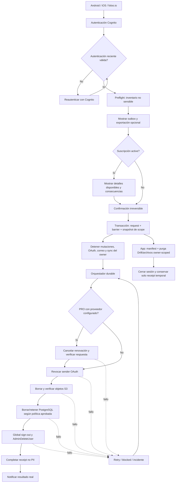
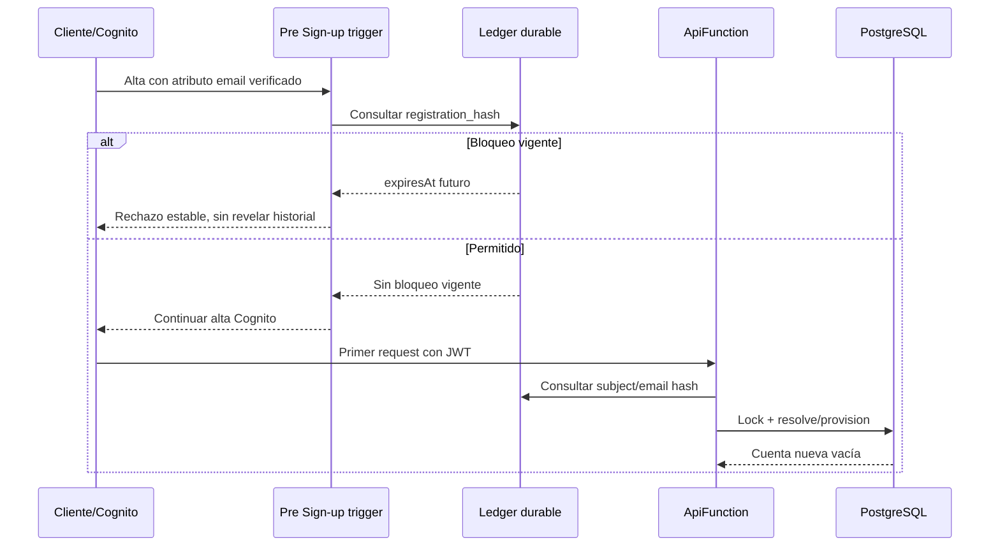

# STORE-02E — Preparación técnica de Account Deletion

- Estado: **DISEÑO TÉCNICO + STORE-02E-01 FORMALIZADA; sin autorización de implementación**
- Fecha: 2026-10-20
- Contrato funcional: [`account-deletion-contract.md`](account-deletion-contract.md)
- API propuesta: [`account-deletion-openapi.yaml`](account-deletion-openapi.yaml)
- Requisitos/trazas:
  [`account-deletion-requirements-traceability.md`](account-deletion-requirements-traceability.md)
- ADR candidatas:
  [`../decisions/ADR-AD-account-deletion-candidates.md`](../decisions/ADR-AD-account-deletion-candidates.md)
- Decisión abierta: `D-13`
- Trazas relacionadas: `AUT-18`–`AUT-21`, `SYN-11`, `SYN-12`, `MON-13`,
  `INF-15`–`INF-21`, `RNF-09`, `RNF-10`, `RC-06`–`RC-10` y E-14; reutiliza
  `AUT-10`, `SYN-01`–`SYN-10`, `INF-02`–`INF-14`, E-09, E-12 y E-13

Este documento prepara STORE-02E sin crear endpoints, migraciones, pantallas,
recursos AWS ni operaciones destructivas. Los nombres de tablas, rutas y
workers son propuestas técnicas. Los acuerdos de Producto no sustituyen las
validaciones Legal, Seguridad, Infra, Operación o Payments registradas en
`D-13`.

## 1. Estado real comprobado en HEAD

### Componentes reutilizables

| Frontera | Evidencia actual | Reutilización posible |
|---|---|---|
| Identidad | `CognitoAuthService`, Amplify Auth y JWT Authorizer; `authenticatedSubject()` acepta únicamente access token y extrae `sub` | Reautenticación mediante Cognito, sesión móvil, ownership por `sub` y autorización API |
| Principal backend | `PostgresRepository.resolvePrincipal()` llama `ensure_personal_workspace(subject)` | Resolución account/workspace, pero debe quedar detrás de la barrera antes de cualquier provisión |
| API | `createRouter()`, envelopes `ApplicationError`, Zod e idempotency keys | Convenciones HTTP, validación, logging sanitizado e idempotencia; no existe ruta de deletion |
| PostgreSQL | Migraciones 001–008 y `schema_migrations`; account/workspace/user, perfil, eventos, Leads, medios, Content, correo e idempotencia | Inventario relacional y transacciones; no existen request, barrier ni retention ledger |
| S3 | Bucket privado, keys derivadas server-side, presigned PUT/GET y confirmación | Resolución segura de objetos; ApiFunction solo tiene `GetObject`/`PutObject`, no delete |
| Email | `EmailApplication`, `PostgresEmailRepository` y `EmailProviderFunction` aislada | Estado de conexión y provider boundary; contrato actual solo autoriza URL, exchange y send, no revoke |
| Offline | Drift v12 y `SyncEngine` owner-scoped con outbox idempotente | Conteo de pendientes, parada por owner y base para cleanup; no existe purga integral |
| Archivos locales | `PrivateMediaStorage` y Content bajo `foloo_media` | Validación de root gestionado y borrado individual; falta manifest de purga por owner |
| Entitlement | `accounts.subscription_status`, `trial_leads_used`, Drift snapshots/reservas y Unlimited DEV | Detección de `active`; no existe proveedor, customer ID, checkout, cancelación o webhook de pagos |
| Infraestructura | CDK DEV con ApiFunction, EmailProviderFunction, MigrationFunction, RDS, S3, Cognito JWT authorizer y endpoints VPC | Patrones de IAM/logs/bundling; no existen Step Functions, workers, barrier store ni finalizer Cognito |

### Funcionalidad inexistente que debe construirse

- Solicitud/preflight, confirmación irreversible y consulta de estado.
- Verificación backend de autenticación reciente.
- Barrera global previa a `ensure_personal_workspace` y bloqueo de todos los
  endpoints/callbacks/replays.
- Bloqueo seudonimizado de registro por 30 días, incluido Cognito federado.
- Orquestación durable e idempotente con workers DB, S3, OAuth y Cognito.
- Revocación OAuth real y destrucción verificable de ciphertext/state/PKCE.
- Purga local transaccional por owner y manifest de archivos reintentable.
- Recurso web `foloo.io/delete-account` y sesión Cognito web/PKCE.
- Provider de pagos y cancelación de renovación; pertenece a FL-021.
- Política de retención, runbooks, operación/alertas y evidencia de cumplimiento.

## 2. Flujo extremo a extremo



La creación inicial de una solicitud es un **preflight revocable** y breve; no
es todavía la aceptación definitiva. Solo `confirm` crea atómicamente la
barrera y convierte el proceso en irreversible. Esta separación satisface la
necesidad de solicitar y confirmar sin afirmar que una cuenta está bloqueada
antes de persistir la barrera.

### Estados propuestos

| Estado | Efecto |
|---|---|
| `awaiting_confirmation` | Preflight temporal; la cuenta sigue operativa y puede abandonarse |
| `requested` | Confirmación aceptada y barrera durable; irreversible |
| `in_progress` | Al menos una etapa ejecutándose o en retry |
| `blocked` | Obligación pendiente que necesita intervención; la cuenta continúa bloqueada |
| `completed` | Todas las obligaciones aprobadas terminaron o quedaron retenidas legítimamente; identidad finalizada |
| `expired` | Solo preflight no confirmado; nunca una solicitud aceptada |

No existe `canceled` después de `requested`. Un fallo no se transforma en éxito
ni elimina la barrera.

### Reautenticación

El backend debe verificar una señal emitida por Cognito; nunca contraseña,
email ni confirmación booleana enviada por Flutter. La propuesta de cinco
minutos necesita un spike con `auth_time` para email/password y Google. Un token
renovado silenciosamente no necesariamente prueba una interacción reciente, por
lo que Seguridad debe aprobar el mecanismo para forzar login/Hosted UI y el
fallback antes de implementar.

## 3. Regla de nuevo registro después de 30 días

### Amenaza concreta

`ensure_personal_workspace(p_subject)` toma lock por `sub` e inserta
`app_users → accounts → workspaces → workspace_members` cuando no encuentra un
workspace activo. Un Cognito `sub` nuevo, especialmente tras Google Hosted UI,
evadiría una barrera basada solo en el `sub` anterior. Bloquear únicamente en
ApiFunction tampoco impide que Cognito cree primero la identidad.

### Alternativas

| Alternativa | Ventajas | Riesgos / límites |
|---|---|---|
| PostgreSQL por `sub` | Simple y consistente con ownership | No detecta un `sub` nuevo; un restore antiguo puede perder el ledger |
| PostgreSQL por HMAC de email verificado | Cubre distintos `sub` | Cognito puede crear la identidad antes del primer API call; restore requiere fuente externa más nueva |
| Cognito Pre Sign-up + ledger externo | Bloquea email/password y federados antes del alta; desacoplado del RDS restaurado | Requiere trigger, disponibilidad fail-closed, manejo de aliases y nueva infraestructura |
| Lista por email en claro | Fácil de operar | Retiene PII innecesaria y queda descartada |

### Recomendación sujeta a Seguridad/Infra

1. Calcular `registration_hash = HMAC-SHA-256(keyVersion,
   canonicalVerifiedEmail)` solo después de verificar el atributo Cognito.
2. Mantener `subject_hash` separado para bloquear sesiones del owner anterior.
3. Usar un ledger durable fuera del ciclo de restore de RDS como autoridad de
   barrera/registro; DynamoDB con cifrado, `expiresAt` y TTL es candidato. La
   aplicación debe evaluar `expiresAt` directamente porque TTL no elimina a una
   hora exacta.
4. Añadir en una fase posterior un Cognito Pre Sign-up trigger que consulte el
   ledger y falle cerrado durante la ventana. Debe cubrir `SignUp` y
   `ExternalProvider`; no intenta vincular cuentas por email.
5. Envolver `ensure_personal_workspace` con una resolución que consulte la
   barrera bajo lock antes de provisionar. Así también quedan bloqueados clientes
   antiguos, sync, callbacks y tokens aún válidos.
6. A los 30 días se permite el alta y se crea un nuevo `sub`, account y
   workspace. No se copian datos, entitlement, trial, perfil o beneficios.

La elegibilidad de trial de esa cuenta nueva está abierta. El ledger no debe
conceder ni negar beneficios hasta que Producto/Legal definan la política
antifraude. Rotación HMAC exige conservar `keyVersion` y capacidad de comparar
las versiones aún vivas, sin guardar email en claro.

### Concurrencia y restauración



El runbook de restore debe restaurar RDS, obtener el ledger actual, reconciliar
requests/barreras y solo entonces abrir tráfico. Un snapshot RDS nunca es la
autoridad para revivir cuentas.

## 4. Matriz técnica de datos y verificación

| Dato | Ubicación / owner actual | Acción candidata | Dependencias/excepción | Verificación |
|---|---|---|---|---|
| Identidad/sesiones | Cognito User Pool; `sub`, username y atributos | Global sign-out y `AdminDeleteUser` al final | Registro de 30 días no conserva Cognito user | `AdminGetUser` devuelve no encontrado; tokens bloqueados además por barrier |
| User/account/workspace/member | PostgreSQL `app_users`, `accounts`, `workspaces`, `workspace_members` | Borrar después de hijos | Barrier/receipt vive fuera de estas filas | Queries por IDs congelados devuelven cero |
| Perfil | `seller_profiles`; Drift `LocalProfiles`; foto privada | Borrar fila, archivo local y objeto remoto si existe | Ninguna retención conocida | Cero filas/objetos/path del owner |
| Events/Leads | PostgreSQL y Drift owner-scoped | Borrado físico ordenado | Datos de terceros: AD-13/Legal | Conteos cero por workspace/owner |
| Media Lead | `lead_media`, S3 y `foloo_media/cards|voice_notes|reference_images` | Congelar keys, borrar S3, metadata y archivos gestionados | No seguir symlinks ni paths fuera del root | `DeleteObjects` sin errores + `HeadObject` no encontrado + manifest local completo |
| Content PDF | `content_files`, S3 y `foloo_media/content` | Borrar binario, metadata y asignaciones | Copias ya enviadas quedan fuera de Foloo | Igual que media; cero filas activas/históricas del workspace |
| Plantillas | `email_templates`, `event_email_templates`; Drift | Borrar | Contienen firma/perfil | Cero filas por workspace/owner |
| Follow-ups/intents | `email_follow_ups`, `email_send_intents`; Drift | Borrar cuerpos, destinatarios, snapshots e IDs provider | Evidencia contable/legal aún no justificada | Cero filas salvo retención aprobada aislada |
| Conexión sender | `email_connections`, OAuth ciphertext, states/PKCE | Revocar proveedor, inutilizar/borrar ciphertext y estados | Provider puede fallar; conservar solo incidente no PII | Revoke confirmado o `blocked`; ciphertext/state ausente |
| Opt-outs/tokens históricos | Tablas email legacy | Borrar o retener mínimo según Legal | Comportamiento activo retirado | Query por workspace/owner/hash según política |
| Idempotencia | `idempotency_records` | Borrar con workspace | Deletion usa ledger separado | Cero filas por workspace |
| Entitlement/trial | columnas `accounts`; Drift `LocalEntitlements`/reservas | Borrar con cuenta/owner | Política antifraude de alta nueva pendiente | Cero snapshots/reservas; cuenta nueva no hereda `active` |
| Outbox | Drift `SyncOperations` | Detener y purgar tras aceptación | Antes se ofrece sync/export | Cero operaciones del owner y timers detenidos |
| Preferencias | `LocalUserPreferences`; legacy `LocalPreferences` | Borrar solo owner-scoped | No adjudicar legacy/global ni otro owner | Query owner cero; globals intactos |
| Temporales/export | Temp app y destino externo | Borrar temporales gestionados | Archivo guardado/compartido queda fuera | Temp no existe; disclosure al usuario |
| Logs | CloudWatch API/provider/migration | Expiración/redacción; no payload/PII | Plazo PROD pendiente | Búsqueda de email/token/payload negativa y retention configurada |
| Backups | RDS snapshots/backups | Propuesta ordinaria 15 días; no edición selectiva | Legal hold separado | Inventario sin backups ordinarios vencidos; restore gate probado |
| Compras/facturas/pagos | Futuro sistema `foloo.io`/provider | Retener solo categorías/plazos exigidos | Legal/Contabilidad/Payments | Evidencia aislada y expiración verificable |
| Receipt/barrier | Nuevo ledger minimizado | Conservar lo mínimo para idempotencia, 30 días y soporte aprobado | HMAC/key version/retención sujetos a Seguridad/Legal | Sin PII cruda; expiry y auditoría comprobables |

Las claves S3 se obtienen antes de borrar metadata. `DeleteObjects` debe revisar
cada elemento de `Deleted` y `Errors`; ausencia previa es éxito idempotente solo
si la key pertenecía al inventario congelado.

## 5. Suscripción PRO futura en `foloo.io`

Hoy `active` es un valor administrado en PostgreSQL; no existen customer ID,
subscription ID, provider ni cancelación. El diseño no puede simular éxito.

### Puerto abstracto propuesto

```text
SubscriptionDeletionPort
  inspect(accountId) -> none | SubscriptionSnapshot
  requestRenewalCancellation(subscriptionRef, idempotencyKey)
    -> confirmed | pending | retryable_failure | permanent_failure
  verifyCancellation(subscriptionRef) -> SubscriptionCancellationStatus
  buildCustomerNotice(snapshot, result) -> NoticeData
```

Reglas:

- referencias provider permanecen cifradas/server-side; Flutter recibe solo
  nombre del plan, estado, renovación/fin cuando sean publicables;
- la cancelación usa su propia idempotency key derivada del deletion request;
- solo `confirmed` permite decir “cancelada”; `pending` se sigue verificando;
- un fallo deja etapa `blocked` o un incidente durable según la política que
  apruebe Payments, sin restaurar la cuenta ni perder capacidad de resolución;
- el email de resultado se envía antes de eliminar la conexión necesaria o por
  un canal transaccional aprobado; hoy Foloo solo envía con sender OAuth del
  vendedor y no posee SES transaccional;
- reembolsos y periodos pagados no se infieren de la cancelación de renovación.

FL-021 debe resolver proveedor/API, D-01–D-04, canal transaccional, políticas
Apple/Google, retries, soporte y retención contable. Hasta entonces esta rama es
una interfaz documental y una etapa opcional no implementable.

## 6. Contratos API propuestos

El borrador completo está en `account-deletion-openapi.yaml`.

| Operación | Auth | Semántica |
|---|---|---|
| `POST /v1/account-deletion-reauthentication/verify` | Cognito access JWT | Comprueba frescura server-side; no recibe credenciales |
| `POST /v1/account-deletion-requests` | JWT reciente + idempotency key | Crea preflight temporal, inventario resumido y `awaiting_confirmation`; no bloquea |
| `POST /v1/account-deletion-requests/{requestId}/confirm` | JWT reciente + idempotency key | Transacción definitiva request+barrier; irreversible |
| `GET /v1/account-deletion-requests/current` | JWT mientras exista Cognito | Consulta estado mínimo de la solicitud del owner |
| `POST /v1/account-deletion-status` | Receipt opaco en body; rate limit | Consulta después de eliminar Cognito; nunca incluye receipt/PII en URL |

El `requestId` es UUID opaco, no secreto ni PII. El receipt sí es secreto de
capacidad: se entrega una vez, solo se persiste su hash, expira, se limita por
IP/dispositivo según política y jamás aparece en URL/log. Las respuestas no
exponen object keys, IDs internos, email, stages internos o errores provider.

Todos los endpoints existentes deben pasar por un guard central previo a
resolver/provisionar principal. Durante `requested|in_progress|blocked` devuelven
un error estable `account_deletion_pending`; callbacks OAuth públicos consultan
state→owner→barrier antes de aceptar el code.

## 7. Experiencia Android/iOS y web

### App móvil

1. Drawer/Perfil → **Cuenta** → **Eliminar cuenta**, separado de logout.
2. Preflight online con alcance, límites externos, máximo operativo sujeto a
   copy legal, outbox y exportación voluntaria.
3. Si hay pendientes: **Sincronizar primero** o **Continuar y eliminar datos no
   sincronizados**, con confirmación explícita.
4. Si existe PRO: estado disponible, efecto sobre renovación y advertencia de
   que cancelación/reembolso no se presumen.
5. Reautenticación Cognito; si no puede completarse, no se crea barrier.
6. Confirmación destructiva accesible y no basada solo en color.
7. Tras aceptación: detener sync, crear manifest, purgar owner, cerrar sesión y
   mostrar estado mediante receipt seguro.
8. `blocked` no dice éxito; ofrece soporte sin reactivar la cuenta.

Copy base ES/EN permanece en el contrato STORE-02D. El texto de 15 días,
retenciones y suscripción no es publicable hasta validación regional.

### Web

- Ruta candidata: `https://foloo.io/delete-account`, aún no publicada.
- Cognito App Client web público con Authorization Code + PKCE y callbacks
  propios; sin Client Secret en navegador.
- Mismo preflight, reautenticación, confirmación y backend que la app.
- Status autenticado mientras exista Cognito; después receipt en body.
- Fallback de soporte requiere verificación humana aprobada; conocer un correo
  no autoriza borrado.

## 8. Matriz de pruebas con datos sintéticos

| Caso | Evidencia esperada |
|---|---|
| FREE con datos / sin datos | Inventario correcto; cleanup total; sin filas/objetos; no hereda trial |
| PRO activo | No afirma cancelación antes de confirmación provider; email/soporte y resolución durable |
| Leads, PDF, fotos y voz | Keys congeladas; S3/DB/local verificados; copias externas declaradas fuera de alcance |
| Offline | No crea solicitud ni muestra aceptación; permite volver a operar |
| Outbox pendiente | Ofrece sync; continuar exige consentimiento; nada se envía tras barrier |
| Exportación | Voluntaria, separada y no bloqueante; archivo externo queda fuera de control |
| Solicitud repetida/simultánea | Misma solicitud/receipt; una sola ejecución; sin doble cancelación/borrado |
| S3 parcial | Retry solo de keys fallidas; no borra metadata necesaria; nunca `completed` prematuro |
| Cognito finalizer falla | Cuenta bloqueada y request reintentable/`blocked`; datos no resucitan |
| Revocación OAuth falla | Ciphertext no vuelve a uso; incidente/retry según política; sin falso éxito |
| Cancelación de suscripción falla | Sin mensaje de cancelación exitosa; caso durable resoluble |
| Web | PKCE, CSRF/state, mismo owner/pipeline, receipt fuera de URL y rate limit |
| Antes de 30 días | Email/password y Google rechazados sin revelar existencia/historial |
| Después de 30 días | `sub`/account/workspace nuevos; cero datos y PRO; trial según política futura |
| Token antiguo | Guard central rechaza todas las mutaciones/pulls/callbacks |
| Restore antiguo | Ledger actual se reaplica antes de tráfico; cuenta no reaparece |
| Dos dispositivos | Segundo dispositivo recibe barrier, detiene sync y purga solo ese owner |
| Multi-owner local | Eliminar A conserva íntegros B y filas legacy owner-null |
| Fallo local de filesystem | Manifest permite retry; no borra fuera de `foloo_media` |
| Logs/receipt | Sin email, token, payload, path, object key, `sub` o IDs internos |

Pruebas destructivas se ejecutarán únicamente en DEV con cuentas/datos
sintéticos y autorización por ejecución. Ningún test usa usuarios reales.

## 9. Plan incremental STORE-02E

| Subtarea | Objetivo y módulos probables | Dependencias/riesgo | Criterio/pruebas | ¿Puede iniciar? |
|---|---|---|---|---|
| `02E-01` Aprobaciones/trazas | `product-spec`, E-14, D-13, roadmap, traceability, OpenAPI | Legal/Seguridad/Infra/Payments y owners | IDs canónicos, criterios y matriz; autorización sigue pendiente | **Completada documentalmente** |
| `02E-02` DDL/barrera | nuevas migraciones; `migration_runner`; wrapper de `resolvePrincipal`; ledger externo/trigger Cognito | Retención, HMAC, 30 días, restore, fail-closed | concurrencia, restore y no reprovisión | Revisión arquitectura/seguridad completada en `account-deletion-architecture-security-review.md`; código bloqueado |
| `02E-03` API/request | `router`, schemas, application/ports, repository, OpenAPI/error envelope | Reauth, receipt, estados y máximo operativo | preflight/confirm idempotentes; token viejo bloqueado | Tests/contrato ahora; código bloqueado |
| `02E-04` Orquestación/workers | CDK state machine, DB/S3/provider/Cognito workers, IAM/logs/runbooks | owner operativo, retention, Payments, permisos destructivos | retries por stage, no cross-owner, alarmas | Diagramas/spikes; recursos bloqueados |
| `02E-05` Flutter | Cuenta UI, auth repository, sync lifecycle, Drift cleanup DAO, filesystem manifest, l10n | copy/reautenticación/seguridad | ES/EN, light/dark, offline, multi-device/owner | Prototipos/tests; código bloqueado |
| `02E-06` Web | `foloo.io`, Cognito web client/PKCE, mismo API/status/soporte | TI, D-21 si aplica, Legal y publicación | E2E web sin secretos ni pipeline alterno | Arquitectura; implementación bloqueada |
| `02E-07` QA/security | fixtures sintéticos, threat model, matrices E2E/store/restore | Componentes 02–06 y autorización destructiva DEV | evidencia completa y redacción de logs | **Sí**, diseño y tests no destructivos |
| `02E-08` Compliance | políticas, Data Safety/App Privacy y cierre de D-13 | evidencia técnica + validación Legal | formularios coherentes, owners y plazos | Bloqueado para cierre |

### Camino crítico recomendado

1. Usar la formalización cerrada de `02E-01` para obtener las aprobaciones
   pendientes, sin confundir el cierre documental con autorización funcional.
2. Revisar y aprobar conjuntamente `ADR-AD-01`–`ADR-AD-05` antes de cualquier
   implementación barrier/ledger/restore de `02E-02`.
3. Implementar primero guard central + DDL/ledger, sin habilitar borrado.
4. Añadir API preflight/confirm detrás de flag interno DEV.
5. Incorporar workers uno por uno con simulación/dry-run y pruebas sintéticas.
6. Implementar cleanup Flutter y luego web sobre el mismo contrato.
7. Integrar Payments únicamente cuando FL-021 entregue un provider real.
8. Ejecutar QA destructivo autorizado y completar compliance.

La primera implementación recomendable es `02E-02` **después** de aprobar
`ADR-AD-01`–`ADR-AD-05`, threat model y validaciones Legal/Seguridad/Infra,
porque toda ruta posterior depende de una barrera anti-resurrección correcta.
`ADR-AD-06` debe aprobarse antes de la confirmación API de `02E-03`. Implementar
primero UI o endpoint destructivo crearía una promesa que el backend actual no
puede cumplir.

## 10. Decisiones y bloqueos antes de escribir código

1. Legal/Contabilidad: categorías, base y plazos por región.
2. Infra/Seguridad: backup ordinario de 15 días y restore con ledger externo.
3. Seguridad: origen/canonicalización del email verificado, HMAC/key rotation,
   almacenamiento del ledger, Pre Sign-up fail-closed y reautenticación.
4. Producto/Legal: copy de outbox, exportación, irreversibilidad y plazo.
5. Operación: owner, retry budgets, alarmas, soporte y escalamiento al día 15.
6. Legal/CBQA: rol y atención de derechos sobre datos de terceros.
7. Dirección/Legal: países, idiomas, menores y promesas regionales.
8. TI: dominio, hosting, App Client web, publicación y operación de `foloo.io`.
9. Payments/FL-021: provider, cancelación, reembolsos, email transaccional y
   políticas Apple/Google.
10. Producto: elegibilidad de trial para la cuenta nueva después de 30 días.

Hasta resolver estos puntos solo están autorizados documentos, diagramas,
threat model, contratos y pruebas no destructivas. STORE-02E permanece sin
implementar y `D-13` abierta.
